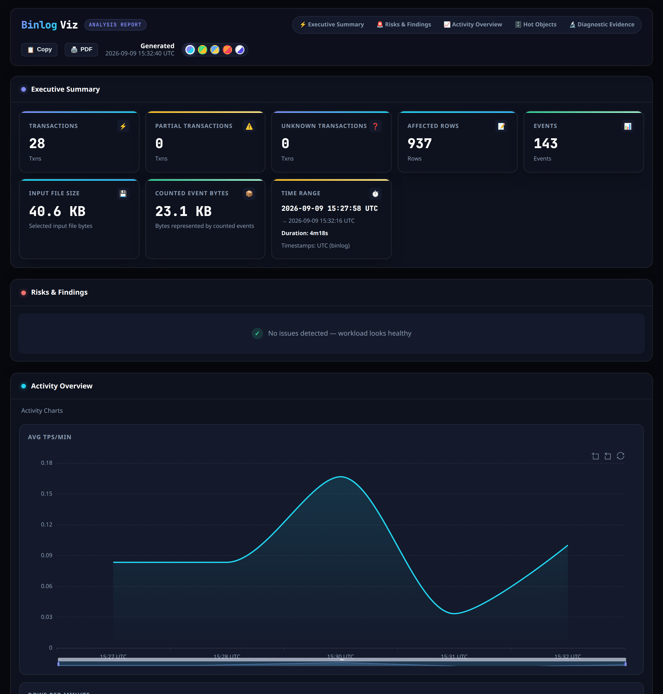
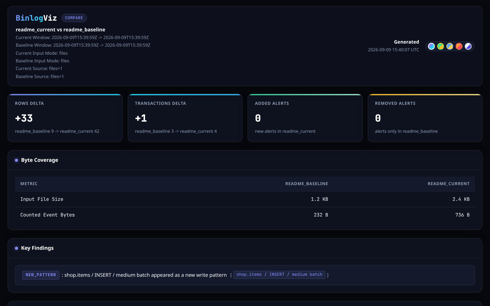

<div align="center">

# BinlogViz

[](https://github.com/Fanduzi/BinlogVisualizer/releases)


[](#license)

[](README.md) [](README_ZH.md)

[](https://github.com/Fanduzi/BinlogVisualizer/blob/main/CHANGELOG.md) [](https://github.com/Fanduzi/BinlogVisualizer/blob/main/SECURITY.md) [](https://github.com/Fanduzi/BinlogVisualizer/tree/main/docs/releases)
</div>

BinlogViz is a local CLI for MySQL `ROW` binlog analysis. It is built for DBAs and operators who need to quickly answer practical questions from real binlog files: which tables are absorbing the most writes, which transactions are unusually large, where spikes happened, and how workload changed over a time window.

BinlogViz is a **fast ROW-binlog summary**: hot tables, write shapes, and before/after compare, in one streaming pass over the files.

It is **not** a full STATEMENT/MIXED analyzer — those files come back empty or undercounted (only ROW images are counted). Printed positions are file evidence, not restore points; [Analyze Behavior](docs/reference/analyze-behavior.md) says when one is safe.

## Screenshots

### Analyze HTML report



### Compare HTML report



## Installation

### Preferred on macOS: Homebrew Cask

Homebrew is **macOS-only**. Linux users should use the tarball or `install.sh` one-liner below.

```bash
brew tap Fanduzi/binlogviz
brew install --cask binlogviz
```

This path installs the prebuilt release artifact and removes the macOS quarantine attribute during installation. Nothing else is needed: DuckDB is built into the binary for `--detail-store duckdb`.

### Linux: install.sh or a tarball

```bash
curl -fsSLO https://raw.githubusercontent.com/Fanduzi/BinlogVisualizer/main/install.sh
sh ./install.sh            # latest release; pin with --version vX.Y.Z
```

`install.sh` downloads the archive for this platform, verifies the sha256 against `checksums.txt` (pass `--no-verify` to skip it on purpose), and installs the binary. It accepts `--version vX.Y.Z`, `--bin-dir DIR`, and `--dry-run`. `/usr/local/bin` needs root: use `sudo`, or `sh ./install.sh --bin-dir ~/.local/bin`.

Tarballs for amd64/arm64 on Linux and macOS are on [GitHub Releases](https://github.com/Fanduzi/BinlogVisualizer/releases); each unpacks loose files (binary, READMEs, `LICENSE`, `docs/`, `testdata/`, `incident.yaml`), so unpack into its own directory.

### Fallback: Build From Source

```bash
git clone https://github.com/Fanduzi/BinlogVisualizer.git
cd BinlogVisualizer

go build -o binlogviz .
go install .
go run . analyze <binlog files...>
```

If you build from source without release ldflags, `binlogviz --version` reports `dev` instead of a tagged release version.

### Verify the Binary

```bash
binlogviz --version
binlogviz version
```

- `binlogviz --version` prints only the version string
- `binlogviz version` prints the ASCII logo plus `binlogviz <version>`

## Quick Start

### Verify the install with the sample ROW binlog

```bash
curl -fsSLO https://raw.githubusercontent.com/Fanduzi/BinlogVisualizer/main/cmd/binlogviz/testdata/minimal.binlog
binlogviz analyze minimal.binlog
```

That prints a Summary, Top Tables, Top Threads, DDL Timeline, Top Transactions and Alerts section. The whole 76-line report of this exact run is [here](https://github.com/Fanduzi/BinlogVisualizer/blob/main/docs/examples/analyze-output.txt), next to the same report as [JSON](https://github.com/Fanduzi/BinlogVisualizer/blob/main/docs/examples/analyze-output.json).

Release archives ship the same sample and an `incident.yaml` that runs from the extract directory. Archive contents, stdin input, Top Threads, Hot Rows, and exit codes are in [Analyze Behavior Details](docs/reference/analyze-behavior.md).

### Inspect one of your own files

```bash
binlogviz analyze mysql-bin.000123
cat mysql-bin.000123 | binlogviz analyze -
```

### Analyze a whole directory in binlog order

```bash
binlogviz analyze --from-dir /var/lib/mysql --prefix mysql-bin.
```

### Read a live server instead of copying files

Remote mode connects as a pseudo-replica (`COM_BINLOG_DUMP`), like `mysqlbinlog -R`. The account needs `REPLICATION SLAVE` and `REPLICATION CLIENT`. The password comes from `BINLOGVIZ_MYSQL_PASSWORD` or `--password` and is never printed.

```bash
export BINLOGVIZ_MYSQL_PASSWORD='secret'
binlogviz analyze --host db.internal --user replica
binlogviz analyze --host db.internal --user replica \
  --start-file binlog.000041 --start-pos 12345     # or --start-gtid 'uuid:1-5' / '0-1-300'
```

The read stops at the end of the `SHOW BINARY LOGS` snapshot taken at connect, so it never races a live writer. Start selectors, `--ssl-mode`, and errors are in [Analyze Behavior Details](docs/reference/analyze-behavior.md#reading-a-binlog-from-a-live-server).

### Narrow to an incident window

```bash
binlogviz analyze --from-dir /var/lib/mysql --prefix mysql-bin. \
  --start "2026-03-15T10:00:00Z" \
  --end "2026-03-15T10:30:00Z"
```

### Start from `SHOW MASTER STATUS` position or GTID

Positions are exact event boundaries on one explicit file and use a half-open `[start, stop)` range. Time flags may be supplied too; the predicates intersect.

```bash
binlogviz analyze mysql-bin.000015 --start-position 1651 --stop-position 4096
binlogviz analyze mysql-bin.000015 --include-gtids '24bc7850-2c16-11e6-a073-0242ac110002:7-12'
binlogviz analyze mariadb-bin.000015 --include-gtids '0-7-1857,0-7-1859' --exclude-gtids '0-7-1859'
```

### Focus on one schema or table

```bash
binlogviz analyze --from-dir /var/lib/mysql --prefix mysql-bin. \
  --include-schema orders \
  --include-table payments
```

### Send machine-readable output to another tool

```bash
binlogviz analyze --from-dir /var/lib/mysql --prefix mysql-bin. --format json > analyze.json
```

### Generate a Markdown or HTML report

```bash
# Markdown — paste into GitHub issues, wikis, or docs
binlogviz analyze mysql-bin.000123 --format markdown > report.md

# HTML — on a terminal this writes mysql-bin.000123.html in the current directory
binlogviz analyze mysql-bin.000123 --format html

# HTML — redirected stdout receives the document instead
binlogviz analyze mysql-bin.000123 --format html > report.html

# HTML — explicit output path
binlogviz analyze mysql-bin.000123 --format html --output report.html

# HTML — force stdout even on a terminal
binlogviz analyze mysql-bin.000123 --format html --output -
```

The HTML report has interactive charts (rows/txns per minute, top tables, operation mix), optional pattern drilldowns, and a five-theme switcher.

## Find and Undo Bad Rows

`flashback` and `redo` print SQL; you review it and run it. Neither connects to a database to write, and both are experimental.

### Find the bad DELETE and see its rows

```bash
binlogviz analyze mysql-bin.000123 \
  --include-table shop.orders \
  --dml delete \
  --start "2026-10-06 14:00:00" \
  --end "2026-10-06 14:10:00" \
  --show-rows
```

### Find an accidental DROP

```bash
binlogviz analyze mysql-bin.000123
```

The report's DDL Timeline lists each `DROP TABLE`, `TRUNCATE`, and `ALTER` with its GTID and start position, to use as the stop GTID or `--stop-position` of a point-in-time restore. See [Find an accidental DROP](docs/recipe/flashback.md#find-an-accidental-drop).

### Undo the bad rows

Find the transaction with `analyze`, the DDL Timeline, or `--show-rows`, then print SQL that reverses only those row changes — from local binlogs or a live server (`--host` plus the remote flags; the read is bounded by the manifest at connect time).

```bash
binlogviz analyze mysql-bin.000123 \
  --include-table shop.orders \
  --dml delete \
  --show-rows

binlogviz flashback mysql-bin.000123 \
  --include-table shop.orders \
  --dml delete \
  --where "user_id < 400" \
  > flashback.sql

binlogviz flashback verify flashback.sql | mysql --default-character-set=utf8mb4
```

`--where` keeps only the rows whose predicate is provably true — `user_id < 400` undoes one user's damage, not the whole table. `--output-dir` splits the undo into independently verifiable files (ADR 0025). `--show-rows` limits, the DDL Timeline stop points, flashback requirements, refusals, conflicts, apply grants, and commit markers are in [Find and Undo Bad Rows](docs/recipe/flashback.md).

### Replay the changes as forward SQL

```bash
binlogviz redo mysql-bin.000123 --include-table shop.orders > redo.sql
```

`redo` prints replayable forward SQL — the `2sql` direction — for the same inputs and selectors as `analyze`, including bounded remote reads. `--output-dir` splits the replay into ordered parts (ADR 0025). [Requirements and refusals](https://github.com/Fanduzi/BinlogVisualizer/blob/main/docs/reference/cli.md#redo-command-syntax).

## Snapshots, Compare, Trend, and Workflow

Save a window once, then compare or trend it later without re-reading the binlogs. `--workload-id` is what lets `compare` and `trend` speak about causes rather than only raw deltas, so pass the same one to both snapshots.

```bash
binlogviz analyze --from-dir /var/lib/mysql --prefix mysql-bin. \
  --start "2026-03-15T10:00:00Z" --end "2026-03-15T10:30:00Z" \
  --workload-id orders-production --format json --snapshot-name incident_current
binlogviz analyze --from-dir /var/lib/mysql --prefix mysql-bin. \
  --start "2026-03-08T10:00:00Z" --end "2026-03-08T10:30:00Z" \
  --workload-id orders-production --format json --snapshot-name incident_baseline

binlogviz compare --current-snapshot incident_current \
  --baseline-snapshot incident_baseline --format html > compare.html
binlogviz trend --from-snapshots 'incident_*' \
  --baseline-snapshot incident_baseline --format html > trend.html
```

`--snapshot-name` still writes the JSON report to `stdout` and saves the same payload under `~/.binlogviz/snapshots/<name>.json`; `snapshot list`, `show`, `rename`, and `delete` manage them. A multi-step investigation runs from one plan file, and the repository ships a runnable `incident.yaml` that points at the sample:

```bash
binlogviz workflow run incident.yaml
```

Comparability, trend ordering, and the `workflow resume`, `status`, `clean`, `export`, `validate`, and `describe` lifecycle are in [Snapshots, Compare, Trend, and Workflow](docs/recipe/compare-trend-workflow.md).

## How BinlogViz Compares

It sits next to the tools a DBA already has and does not replace them. What differs is what each one takes and gives back:

| Tool | Takes → gives | Reach for it when |
|---|---|---|
| `mysqlbinlog` | binlog → decoded events | You need the exact event stream or a byte range. BinlogViz prints ready-to-copy `mysqlbinlog` commands for the transactions it ranks. |
| `pt-query-digest` | slow query log → query digest | The question is which queries are slow. It does not read binlogs. |
| `binlog2sql`, `my2sql` | binlog → undo or redo SQL, and for `my2sql` stats | You want a script from one stream. BinlogViz covers undo and replay as well, and adds the report, snapshot, and compare surfaces plus a verifier for the script it prints. |

This is a map of inputs and outputs, not a benchmark of those tools. [Analyze Behavior](docs/reference/analyze-behavior.md) has this tool's measured cost on two real binlogs, and [Why is my replica lagging?](docs/reference/analyze-behavior.md#why-is-my-replica-lagging) covers the replica question.

## Language Support

Runtime output — errors, reports, progress, and the text tables — is English or Simplified Chinese. Pick it with `--lang zh-CN` or let `LANG=zh_CN.UTF-8` decide; `en` is the default.

```bash
binlogviz --lang zh-CN analyze mysql-bin.000123
```

`--help` stays in English, because help text is built before the language is initialized.

## Documentation by Task

- **First run:** [Quickstart](https://github.com/Fanduzi/BinlogVisualizer/blob/main/docs/recipe/quickstart.md), [Analyze Local Binlogs](https://github.com/Fanduzi/BinlogVisualizer/blob/main/docs/recipe/analyze-local-binlogs.md), [Troubleshoot Common Errors](https://github.com/Fanduzi/BinlogVisualizer/blob/main/docs/recipe/troubleshoot-common-errors.md)
- **Recovery:** [Find and Undo Bad Rows](docs/recipe/flashback.md), [Replay as Forward SQL](https://github.com/Fanduzi/BinlogVisualizer/blob/main/docs/reference/cli.md#redo-command-syntax), [Snapshots, Compare, Trend, and Workflow](docs/recipe/compare-trend-workflow.md)
- **Contracts:** [CLI Reference](https://github.com/Fanduzi/BinlogVisualizer/blob/main/docs/reference/cli.md), [Output Format](https://github.com/Fanduzi/BinlogVisualizer/blob/main/docs/reference/output-format.md), [Input Discovery](https://github.com/Fanduzi/BinlogVisualizer/blob/main/docs/reference/input-discovery.md), [Analyze Behavior](docs/reference/analyze-behavior.md)
- **Model and limits:** [Architecture](docs/concept/architecture.md), [Analysis Model](https://github.com/Fanduzi/BinlogVisualizer/blob/main/docs/concept/analysis-model.md), [Limitations](https://github.com/Fanduzi/BinlogVisualizer/blob/main/docs/concept/limitations.md), [DuckDB Temp Store](https://github.com/Fanduzi/BinlogVisualizer/blob/main/docs/concept/duckdb-temp-store.md)
- **Elsewhere:** [all docs](https://github.com/Fanduzi/BinlogVisualizer/blob/main/docs/README.md), [examples](https://github.com/Fanduzi/BinlogVisualizer/tree/main/docs/examples), [release notes](https://github.com/Fanduzi/BinlogVisualizer/tree/main/docs/releases), [changelog](https://github.com/Fanduzi/BinlogVisualizer/blob/main/CHANGELOG.md), [security policy](https://github.com/Fanduzi/BinlogVisualizer/blob/main/SECURITY.md)

## Architecture

The Cobra command layer streams normalized binlog events into the analyzer, then hands the result to report, snapshot, compare, trend, and workflow modules. The pipeline and the module table are in [Architecture](docs/concept/architecture.md).

## Requirements

- `ROW` binlogs from MySQL 5.7+ and MariaDB 10.11+ (the versions tested), on disk, on stdin, or from a live server
- `flashback`/`redo`: binlogs written with `FULL` row images; column names and the key come from `FULL` row metadata when recorded, otherwise from `--schema-file` (so MySQL 8.x `MINIMAL` and 5.7 work with a dump); the generated script applies to a MySQL target only
- Go 1.26.10+ if building from source

## License

Apache 2.0
