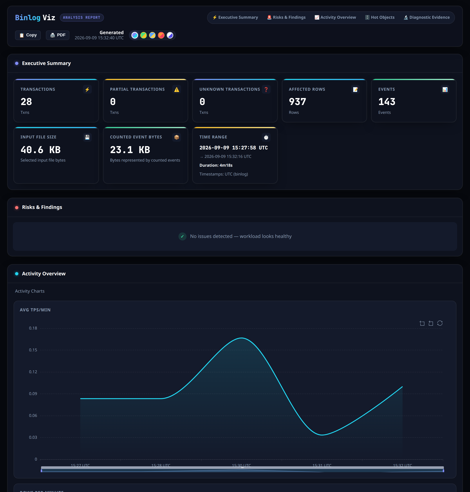
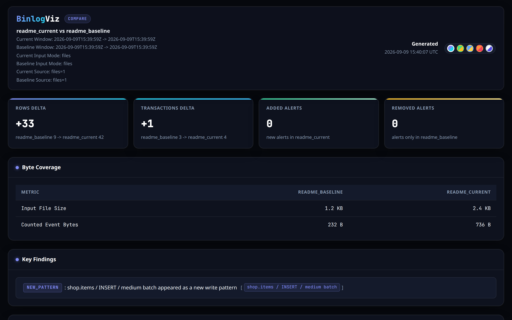

<div align="center">

# BinlogViz

[](https://github.com/Fanduzi/BinlogVisualizer/releases)


[](#license)

[](README.md) [](README_ZH.md)

[](https://github.com/Fanduzi/BinlogVisualizer/blob/main/CHANGELOG.md) [](https://github.com/Fanduzi/BinlogVisualizer/blob/main/SECURITY.md) [](https://github.com/Fanduzi/BinlogVisualizer/tree/main/docs/releases)
</div>

BinlogViz 是一个面向 DBA 和运维人员的本地 MySQL `ROW` binlog 分析 CLI。它专门用于回答真实运维问题：哪些表写入最重、哪些事务异常大、尖峰发生在哪些分钟、某个故障窗口内的负载究竟发生了什么。

BinlogViz 做的是 **ROW binlog 的快速摘要**：热表、写入形态、上线前后 compare，对文件做一次流式扫描。

它**不是** STATEMENT / MIXED 全量分析器——这类文件会空成功或只统计到 ROW 子集。报告里的位置是文件证据，不是恢复点；什么时候可以拿来用见 [Analyze 行为细节](docs/reference/analyze-behavior.zh-CN.md)。

## 截图

### Analyze HTML 报告



### Compare HTML 报告



## 安装

### macOS 首选：Homebrew Cask

Homebrew **仅适用于 macOS**。Linux 请用下面的 tarball 或 `install.sh`。

```bash
brew tap Fanduzi/binlogviz
brew install --cask binlogviz
```

这条路径会安装预编译 release artifact，并在安装时移除 macOS quarantine 属性。不需要其他依赖：DuckDB 已经编进二进制，供 `--detail-store duckdb` 使用。

### Linux：install.sh 或 tarball

```bash
curl -fsSLO https://raw.githubusercontent.com/Fanduzi/BinlogVisualizer/main/install.sh
sh ./install.sh            # latest release; pin with --version vX.Y.Z
```

`install.sh` 会下载本平台的归档，用 `checksums.txt` 校验 sha256（确实要跳过时传 `--no-verify`），然后安装二进制。它支持 `--version vX.Y.Z`、`--bin-dir DIR` 和 `--dry-run`。写入 `/usr/local/bin` 需要 root：用 `sudo`，或者用 `sh ./install.sh --bin-dir ~/.local/bin` 装到自己有权限的目录。

Linux 和 macOS 的 amd64/arm64 归档见 [GitHub Releases](https://github.com/Fanduzi/BinlogVisualizer/releases)；每个归档解压出来是散落的文件（二进制、两份 README、`LICENSE`、`docs/`、`testdata/`、`incident.yaml`），所以先解压到单独的目录。

### 备选：从源码构建

```bash
git clone https://github.com/Fanduzi/BinlogVisualizer.git
cd BinlogVisualizer

go build -o binlogviz .
go install .
go run . analyze <binlog files...>
```

如果你从源码构建且没有注入 release ldflags，那么 `binlogviz --version` 会显示 `dev`，而不是某个发布版本号。

### 验证二进制

```bash
binlogviz --version
binlogviz version
```

- `binlogviz --version` 只输出版本号
- `binlogviz version` 输出 ASCII Logo 加 `binlogviz <version>`

## 快速开始

### 用样例 ROW binlog 验证安装

```bash
curl -fsSLO https://raw.githubusercontent.com/Fanduzi/BinlogVisualizer/main/cmd/binlogviz/testdata/minimal.binlog
binlogviz analyze minimal.binlog
```

它会打印 Summary、热点表、热点线程、DDL 时间线、重点事务和关键发现。这次运行完整的 76 行报告在[这里](https://github.com/Fanduzi/BinlogVisualizer/blob/main/docs/examples/analyze-output.txt)，同一份报告的 [JSON](https://github.com/Fanduzi/BinlogVisualizer/blob/main/docs/examples/analyze-output.json) 也在旁边。

Release 归档也带这份样本，以及解压后即可运行的 `incident.yaml`。归档内容、stdin 输入、热点线程、热点行和退出码见 [Analyze 行为细节](docs/reference/analyze-behavior.zh-CN.md)。

### 检查你自己的文件

```bash
binlogviz analyze mysql-bin.000123
cat mysql-bin.000123 | binlogviz analyze -
```

### 按 binlog 顺序分析整个目录

```bash
binlogviz analyze --from-dir /var/lib/mysql --prefix mysql-bin.
```

### 直接读取存活服务器，无需复制文件

远程模式以伪副本身份连接（`COM_BINLOG_DUMP`），等价于 `mysqlbinlog -R`。账号需要 `REPLICATION SLAVE` 和 `REPLICATION CLIENT`。密码来自 `BINLOGVIZ_MYSQL_PASSWORD` 或 `--password`，绝不打印。

```bash
export BINLOGVIZ_MYSQL_PASSWORD='secret'
binlogviz analyze --host db.internal --user replica
binlogviz analyze --host db.internal --user replica \
  --start-file binlog.000041 --start-pos 12345     # 或 --start-gtid 'uuid:1-5' / '0-1-300'
```

读取在连接时快照的 `SHOW BINARY LOGS` 末尾处停止，不会追赶正在写入的服务器。起点选择器、`--ssl-mode` 和错误契约见 [Analyze 行为细节](docs/reference/analyze-behavior.zh-CN.md)。

### 聚焦某个故障时间窗口

```bash
binlogviz analyze --from-dir /var/lib/mysql --prefix mysql-bin. \
  --start "2026-03-15T10:00:00Z" \
  --end "2026-03-15T10:30:00Z"
```

### 从 `SHOW MASTER STATUS` 位点或 GTID 起

位点是单个显式文件上的精确事件边界，使用半开区间 `[start, stop)`。也可以同时给时间条件；各谓词取交集。

```bash
binlogviz analyze mysql-bin.000015 --start-position 1651 --stop-position 4096
binlogviz analyze mysql-bin.000015 --include-gtids '24bc7850-2c16-11e6-a073-0242ac110002:7-12'
binlogviz analyze mariadb-bin.000015 --include-gtids '0-7-1857,0-7-1859' --exclude-gtids '0-7-1859'
```

### 只看某个 schema 或表

```bash
binlogviz analyze --from-dir /var/lib/mysql --prefix mysql-bin. \
  --include-schema orders \
  --include-table payments
```

### 把机器可读结果交给脚本或其他工具

```bash
binlogviz analyze --from-dir /var/lib/mysql --prefix mysql-bin. --format json > analyze.json
```

### 生成 Markdown 或 HTML 报告

```bash
# Markdown — 粘贴到 GitHub issue、wiki 或文档
binlogviz analyze mysql-bin.000123 --format markdown > report.md

# HTML — 在终端里运行会写入当前目录的 mysql-bin.000123.html
binlogviz analyze mysql-bin.000123 --format html

# HTML — 重定向后文档走 stdout，不生成文件
binlogviz analyze mysql-bin.000123 --format html > report.html

# HTML — 指定输出路径
binlogviz analyze mysql-bin.000123 --format html --output report.html

# HTML — 即使有终端也强制走 stdout
binlogviz analyze mysql-bin.000123 --format html --output -
```

HTML 报告包含交互式图表（每分钟行数/事务数、热点表、操作类型分布）、可选模式钻取，以及五主题切换器。

## 找到并撤销误改的行

`flashback` 和 `redo` 只打印 SQL：你审阅、你自己执行，两者都不会连库写入，并且都是实验功能。

### 找到误删并看到被删的行

```bash
binlogviz analyze mysql-bin.000123 \
  --include-table shop.orders \
  --dml delete \
  --start "2026-10-06 14:00:00" \
  --end "2026-10-06 14:10:00" \
  --show-rows
```

### 找到误操作的 DROP

```bash
binlogviz analyze mysql-bin.000123
```

报告里的 DDL 时间线列出每条 `DROP TABLE`、`TRUNCATE` 和 `ALTER` 的 GTID 和起始位置，可直接用作时间点恢复的 stop GTID 或 `--stop-position`。见 [找到误操作的 DROP](docs/recipe/flashback.zh-CN.md#找到误操作的-drop)。

### 撤销误改的行

先用 `analyze`、DDL 时间线或 `--show-rows` 找到那个事务，再打印只撤销这些行变更的 SQL——本地 binlog 或在线服务器（`--host` 加远程参数；读取以连接时的 binlog 清单为界）都可以。

```bash
binlogviz analyze mysql-bin.000123 \
  --include-table shop.orders \
  --dml delete \
  --show-rows

binlogviz flashback mysql-bin.000123 \
  --include-table shop.orders \
  --dml delete \
  --where "user_id < 400" \
  > flashback.sql

binlogviz flashback verify flashback.sql | mysql --default-character-set=utf8mb4
```

`--where` 只保留谓词可证为真的行——`user_id < 400` 只撤一个用户的误改，而不是整表。`--output-dir` 把撤销拆成可独立校验的文件（ADR 0025）。`--show-rows` 的上限、DDL 时间线的停止点、flashback 的前提条件、拒绝情形、冲突、执行权限和提交标记见 [找到并撤销误改的行](docs/recipe/flashback.zh-CN.md)。

### 把变更重演成前滚 SQL

```bash
binlogviz redo mysql-bin.000123 --include-table shop.orders > redo.sql
```

`redo` 打印可重放的前滚 SQL——即 `2sql` 方向——输入和选择条件与 `analyze` 相同，包括有界远端读取。`--output-dir` 把重演拆成有序的部分文件（ADR 0025）。[前提条件和拒绝情形](https://github.com/Fanduzi/BinlogVisualizer/blob/main/docs/reference/cli.zh-CN.md#redo-命令语法)。

## 快照、对比、趋势与 workflow

窗口只需读一次：存成快照之后，compare 和 trend 不必再扫 binlog。`--workload-id` 决定 compare 和 trend 能不能谈原因、而不只是谈原始差值，所以两张快照要传同一个。

```bash
binlogviz analyze --from-dir /var/lib/mysql --prefix mysql-bin. \
  --start "2026-03-15T10:00:00Z" --end "2026-03-15T10:30:00Z" \
  --workload-id orders-production --format json --snapshot-name incident_current
binlogviz analyze --from-dir /var/lib/mysql --prefix mysql-bin. \
  --start "2026-03-08T10:00:00Z" --end "2026-03-08T10:30:00Z" \
  --workload-id orders-production --format json --snapshot-name incident_baseline

binlogviz compare --current-snapshot incident_current \
  --baseline-snapshot incident_baseline --format html > compare.html
binlogviz trend --from-snapshots 'incident_*' \
  --baseline-snapshot incident_baseline --format html > trend.html
```

`--snapshot-name` 仍然把 JSON 报告写到 `stdout`，同时把同一份载荷存到 `~/.binlogviz/snapshots/<name>.json`；`snapshot list`、`show`、`rename`、`delete` 管理它们。多步调查可以用一份 plan 文件跑，仓库自带一份指向样本、可直接运行的 `incident.yaml`：

```bash
binlogviz workflow run incident.yaml
```

可比性、trend 排序，以及 `workflow resume`、`status`、`clean`、`export`、`validate`、`describe` 的生命周期见 [快照、对比、趋势与 workflow](docs/recipe/compare-trend-workflow.zh-CN.md)。

## 和其它工具怎么分工

它和 DBA 手上已有的工具并排使用，不替代它们。区别在于各自收什么、给什么：

| 工具 | 收 → 给 | 什么时候用它 |
|---|---|---|
| `mysqlbinlog` | binlog → 解码后的事件 | 需要精确的事件流或字节区间。BinlogViz 会为它排出的重点事务直接打印可复制的 `mysqlbinlog` 命令。 |
| `pt-query-digest` | 慢查询日志 → 查询摘要 | 问题是“哪些 SQL 慢”。它不读 binlog。 |
| `binlog2sql`、`my2sql` | binlog → 撤销或前滚 SQL；`my2sql` 还有统计 | 你想从一条流里得到脚本。BinlogViz 同样能做撤销和重放，另外多出报告、快照和对比这三层，以及给生成的脚本配一个校验器。 |

这张表说的是输入输出的边界，不是这些工具的性能对比。本工具在真实 binlog 上的实测成本见 [Analyze 行为细节](docs/reference/analyze-behavior.zh-CN.md)，副本延迟问题见 [为什么副本在延迟？](docs/reference/analyze-behavior.zh-CN.md#为什么副本在延迟)。

## 多语言支持

运行时输出——错误、报告、进度和文本表格——支持英文和简体中文。用 `--lang zh-CN` 指定，或者让 `LANG=zh_CN.UTF-8` 决定；默认是 `en`。

```bash
binlogviz --lang zh-CN analyze mysql-bin.000123
```

`--help` 仍是英文，因为 help 文本在语言初始化之前就生成了。

## 按任务阅读文档

- **第一次跑：** [快速开始](https://github.com/Fanduzi/BinlogVisualizer/blob/main/docs/recipe/quickstart.zh-CN.md)、[分析本地 binlog](https://github.com/Fanduzi/BinlogVisualizer/blob/main/docs/recipe/analyze-local-binlogs.zh-CN.md)、[常见错误排查](https://github.com/Fanduzi/BinlogVisualizer/blob/main/docs/recipe/troubleshoot-common-errors.zh-CN.md)
- **恢复数据：** [找到并撤销误改的行](docs/recipe/flashback.zh-CN.md)、[重放为前滚 SQL](https://github.com/Fanduzi/BinlogVisualizer/blob/main/docs/reference/cli.zh-CN.md#redo-command-syntax)、[快照、对比、趋势与 workflow](docs/recipe/compare-trend-workflow.zh-CN.md)
- **精确契约：** [CLI 参考](https://github.com/Fanduzi/BinlogVisualizer/blob/main/docs/reference/cli.zh-CN.md)、[输出格式](https://github.com/Fanduzi/BinlogVisualizer/blob/main/docs/reference/output-format.zh-CN.md)、[输入发现](https://github.com/Fanduzi/BinlogVisualizer/blob/main/docs/reference/input-discovery.zh-CN.md)、[Analyze 行为细节](docs/reference/analyze-behavior.zh-CN.md)
- **模型与边界：** [产品架构](docs/concept/architecture.zh-CN.md)、[分析模型](https://github.com/Fanduzi/BinlogVisualizer/blob/main/docs/concept/analysis-model.zh-CN.md)、[限制与边界](https://github.com/Fanduzi/BinlogVisualizer/blob/main/docs/concept/limitations.zh-CN.md)、[DuckDB 临时存储](https://github.com/Fanduzi/BinlogVisualizer/blob/main/docs/concept/duckdb-temp-store.zh-CN.md)
- **其它：** [全部文档](https://github.com/Fanduzi/BinlogVisualizer/blob/main/docs/README.md)、[示例输出](https://github.com/Fanduzi/BinlogVisualizer/tree/main/docs/examples)、[发行说明](https://github.com/Fanduzi/BinlogVisualizer/tree/main/docs/releases)、[变更记录](https://github.com/Fanduzi/BinlogVisualizer/blob/main/CHANGELOG.md)、[安全策略](https://github.com/Fanduzi/BinlogVisualizer/blob/main/SECURITY.md)

## 架构

Cobra 命令层把规范化后的 binlog 事件流式交给分析器，再把结果交给 report、snapshot、compare、trend 和 workflow 模块。流水线和模块表见 [产品架构](docs/concept/architecture.zh-CN.md)。

## 环境要求

- MySQL 5.7+ 和 MariaDB 10.11+（已实测的版本）的 `ROW` binlog，来自磁盘、stdin，或直接读取存活服务器
- `flashback`/`redo`：需要写入时带 `FULL` 行镜像的 binlog；列名和主键优先取记录下来的 `FULL` 行元数据，没有时来自 `--schema-file`（所以 MySQL 8.x 的 `MINIMAL` 与 5.7 配上转储也能撤销）；生成的脚本只能在 MySQL 目标上执行
- 如果从源码构建，需要 Go 1.26.10+

## License

Apache 2.0
